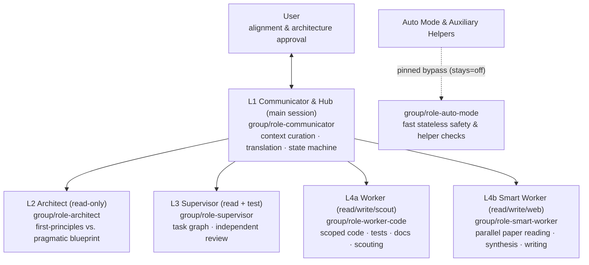

<div align="center">

# commlaude

**A directory-isolated, communication-first multi-model orchestration layer for Claude Code.**

Route conversational coordination, read-only architecture, independent review, fast execution, parallel deep research, and Auto Mode classification to separate model groups — without touching `~/.claude` or existing Magpie bindings.

[](https://github.com/zhubaodian1027/commlaude/stargazers)


**English** · [简体中文](./README_zh.md)

[Quickstart](#60-second-quickstart) · [Why commlaude](#why-commlaude) · [Entry Points](#six-entry-points) · [Architecture](#architecture--role-groups) · [Verification](#verification--attribution) · [Uninstall](#uninstall--rollback)

</div>

---



```text
$ ./bin/orchestra-audit --since '2026-11-23T00:00:00Z'
| Requested                | Served         | Calls | Avg ms | Errors |
| ------------------------ | -------------- | ----- | ------ | ------ |
| group/role-communicator  | <hub-model>    |    12 |   6420 |      0 |
| group/role-architect     | <arch-model>   |     2 |  18900 |      0 |
| group/role-supervisor    | <review-model> |     4 |  14300 |      0 |
| group/role-worker-code   | <code-model>   |     8 |   4150 |      0 |
| group/role-smart-worker  | <smart-model>  |     5 |  22100 |      0 |
| group/role-auto-mode     | <fast-model>   |    19 |    910 |      0 |
```

> [!NOTE]
> `commlaude` keeps all configuration, agents, skills, commands, session history, and smoke-test artifacts inside its own repository directory via `CLAUDE_CONFIG_DIR`. Your global `~/.claude/` directory and existing Magpie main/tier/subagent bindings remain untouched.

---

## Why `commlaude`?

### Origin: Rethinking "Smartest Model on Top"

Most multi-agent setups default to the same hierarchy: put the highest-IQ reasoning model in the main chat and let it drive faster worker subagents.

In daily use, that pattern broke down for me. I rely on models like **GPT-6 Astra / GPT-6.2 Astra** for top-tier intelligence on hard design calls and reference checks, but talking to them directly is draining — they rarely speak plainly and bury real conclusions under layers of defensive hedging. By contrast, **Gemini 4 Neon** hits a rare balance in practice: solid intelligence, strong execution, high speed, and above all, **clear, direct human communication** (the last model that felt that good to converse with was **Kimi K3**, before **K3.1 Pro** was post-trained back into stiff, over-guarded phrasing).

That experience led to a simple conclusion: **in interactive workflows, a model's ability to speak plainly affects both experience and task velocity more than raw peak IQ.** When your front-end model cannot communicate crisply, alignment stalls and every turn drags.

`commlaude` flips the conventional subagent pattern into a **Communication-First** workflow: put the clearest communicator in the driver's seat as the main hub, call frontier reasoning models behind the scenes strictly for high-leverage thinking and review, and keep every role bound to a semantic `group/role-*` route so a post-training regression never forces you to rewrite your setup.

To make that practical without sacrificing architectural rigor or safety, `commlaude` separates concerns into **6 semantic routing groups** and **6 command speeds** with strict boundaries:

- **Communication-First Hub (Depth-1 Flat Orchestration)**: Claude Code subagents cannot spawn sub-subagents. L1 stays the sole coordinator — curating concise briefs (`00-brief.md`), dispatching independent tasks in parallel waves, and keeping context clean.
- **Voice Isolation ("Thinker Thinks, Communicator Speaks")**: L2 Architect is strictly read-only and outputs raw **Bold/First-Principles vs. Pragmatic** blueprints. L1 translates them into plain trade-offs, adds an independent engineering critique, and waits for explicit human approval before any code is written.
- **Write/Review Separation & Bounded Loops**: Workers edit only `allowed_files` and must run `verification_cmd`. L3 Supervisor has `Read` + `Bash` to run tests independently, has no `Write`/`Edit` tools, and caps revision loops at **2 rounds per task packet**.
- **Model-Agnostic Routing**: Zero vendor or model names are hardcoded in agents, skills, or commands. Every role binds to `group/role-*`; swap models, adjust fallback chains, or apply schedules at the gateway layer without editing prompts.

### How it compares

| Capability | Single-Model Claude Code | Ad-Hoc Subagent Prompts | `commlaude` |
| --- | :---: | :---: | :---: |
| Separate models for comm, architecture, review, fast code & deep batch work | No | Manual | **6 semantic `group/role-*` groups** |
| Read-only architect + human approval gate before edits | No | Prompt-only | **Enforced tool & workflow gate** |
| Independent reviewer with test execution and no file-write tools | No | Rarely | **Enforced (`Read/Grep/Glob/Bash`)** |
| Native parallel batch research/writing (`Agent` waves, not shell scripts) | Manual | Ad-hoc | **`/smarter` + `smart-worker`** |
| Auto Mode permission classifier pinned away from main model | No | No | **`CLAUDE_CODE_AUTO_MODE_SERVER=0`** |
| Zero modification to `~/.claude/` & reversible install | N/A | Mutates global config | **Isolated dir + `./uninstall.sh`** |
| Post-run `Requested` vs `Served` model attribution audit | No | No | **`./bin/orchestra-audit`** |

---

## 60-Second Quickstart

**Prerequisites**: macOS / Unix, Claude Code CLI (`/opt/homebrew/bin/claude` or `CLAUDE_BIN`), a running local Magpie gateway on `http://127.0.0.1:3425` (or any Anthropic-compatible gateway supporting group IDs), and Python 3 (stdlib only, 0 third-party dependencies).

```bash
# 1. Clone the repository
git clone https://github.com/zhubaodian1027/commlaude.git && cd commlaude

# 2. Provision the 6 group/role-* routing groups (auto-saves a Magpie rollback snapshot first)
./setup-magpie.sh

# 3. Verify static config and launch the isolated Claude Code environment
./bin/orchestra-verify && ./bin/claude-orchestra
```

Expected verification output:

```text
OK: 21 required files, agent routing, tool restrictions, and script syntax verified.
Isolated config: <repo>/.claude
Live Magpie routing is checked separately by scripts/routing_smoke_test.sh.
```

<details>
<summary><strong>Optional: install the <code>commlaude</code> shell alias</strong></summary>

Add this marked block to `~/.zshrc` (the uninstall script recognizes and removes only this block):

```zsh
# >>> commlaude isolated launcher >>>
alias commlaude='/path/to/commlaude/bin/claude-orchestra'
# <<< commlaude isolated launcher <<<
```

Then run `source ~/.zshrc` and launch from any project directory:

```bash
commlaude
commlaude --resume
commlaude --version
```

</details>

<details>
<summary><strong>Optional: override default models via environment variables</strong></summary>

`setup-magpie.sh` ships with reference defaults, but every group accepts a comma-separated priority list (`primary,fallback,...`) without editing any file:

```bash
ROLE_COMMUNICATOR_MODELS="<primary>,<fallback>" \
ROLE_ARCHITECT_MODELS="<primary>,<fallback>" \
ROLE_SUPERVISOR_MODELS="<primary>,<fallback>" \
ROLE_WORKER_CODE_MODELS="<primary>,<fallback>" \
ROLE_SMART_WORKER_MODELS="<primary>,<fallback>" \
ROLE_AUTO_MODE_MODELS="<primary>,<fallback>" \
./setup-magpie.sh
```

Safety checks built into `setup-magpie.sh`:
1. Saves a timestamped Magpie rollback profile on first run (recorded only in gitignored `.magpie-setup-state`).
2. Refuses to overwrite pre-existing `group/role-*` groups that were not created by this installation.
3. Never changes existing Magpie main, tier, or global subagent bindings.

</details>

---

## Six Entry Points

Pick the lowest-ceremony command that matches task risk:

| Command | Path | Best For | Guardrails |
| --- | --- | --- | --- |
| `/astra <question>` | `User ↔ L1 ↔ L2` | Architecture design, hard debugging, first-principles trade-offs | Strictly read-only; no code edits |
| `/reviewer <target>` | `User ↔ L1 → L3` | Standalone independent review of code, diffs, commits/PRs, tests, or documents | Reuses `kimi-supervisor` directly in `MODE: REVIEW`; strictly read-only + safe verification, **no decomposition or worker dispatch** |
| `/worker <small task>` | `User ↔ L1 → L4a` | Clear single-packet edits, bug fixes, tests, docs, or read-only scouting | Runs `worker` (`Execution Mode` by default, `Scout Mode` read-only); **no independent review** |
| `/smarter <batch/creative task>` | `User ↔ L1 → parallel L4b` | Deep paper reading, literature synthesis, research writing, complex batch analysis | Dispatches native parallel `Agent` waves via `smart-worker` (`effort=high`, disjoint `allowed_files`); **no Kimi code-review loop** |
| `/kimi <clear task>` | `User ↔ L1 → L3 → L4 → L3` | Well-defined feature implementation, scoped refactors, multi-file fixes | Skips architecture gate; keeps independent test execution and review (pure read-only review requests short-circuit directly to `MODE: REVIEW`) |
| `/commlaude <complex task>` | `User ↔ L1 ↔ L2 → [Approval] → L3 ↔ L4` | Ambiguous features, large refactors, research-to-code work | **Human must approve blueprint before edits**; max 2 revision rounds per packet |

Multi-step runs persist auditable artifacts in the target project's `.orchestra/` directory:

```text
<project>/.orchestra/<YYYYMMDD-HHMMSS>-<slug>/
├── 00-brief.md          # L1 goal, constraints, non-goals, done criteria
├── 01-blueprint.md      # L2 raw blueprint + recorded human approval decision
├── 02-tasks.json        # L3 atomic task graph (dependencies, allowed_files, verification_cmd)
├── 03-reports/          # L4 per-packet execution & verification reports
└── 04-review.md         # L3 independent test runs & per-round verdicts
```

---

## Architecture & Role Groups

All agents, skills, and commands bind exclusively to these **6 semantic routing groups**. Fill each group in Magpie according to capability profile rather than brand name:

| Layer | Routing Group | Tool Boundary | Recommended Capability Profile | Default Policy |
| --- | --- | --- | --- | --- |
| **L1 Hub** | `group/role-communicator` | Main session orchestrator | Natural communication, strong context curation, translation, state tracking | `routing=order` `stays=session` |
| **L2 Architect** | `group/role-architect` | Read-only + Web | Deep first-principles reasoning, failure-mode modeling, dual-option design | `routing=order` `stays=session` |
| **L3 Supervisor** | `group/role-supervisor` | Read-only + `Bash` tests | Strict task decomposition, edge-case sensitivity, independent code review | `routing=order` `stays=session` |
| **L4a Worker** | `group/role-worker-code` | Read/Write + `Bash` + Scout | Fast, cost-effective implementation, tests, docs, and read-only scouting | `routing=order` `stays=auto` |
| **L4b Smart Worker** | `group/role-smart-worker` | Read/Write + `Bash` + Web | High reasoning, long-document fidelity, creative synthesis & batch analysis | `routing=order` `stays=session` |
| **Auto Mode & Helpers** | `group/role-auto-mode` | Classifier & auxiliary helpers | Ultra-low latency, low cost, stateless permission checks, titles & summaries | `routing=order` `stays=off` |

> [!TIP]
> Reorder any role's fallback chain at runtime without restarting or editing prompts:
> ```bash
> magpie group set role-auto-mode models=<model-a>,<model-b>
> ```

---

## Verification & Attribution

### Static checks & unit tests (no model calls)

```bash
./bin/orchestra-verify
python3 -I -m unittest discover -s ./tests -p 'test_*.py'
```

### Live routing probe & model attribution audit

```bash
# Sends one minimal probe to each of the 4 subagent groups and verifies logs
./scripts/routing_smoke_test.sh

# Inspects metadata only from local Magpie usage.jsonl (no prompts or keys)
./bin/orchestra-audit
./bin/orchestra-audit --since '2026-11-20T00:00:00Z'
```

`orchestra-audit` reports both `Requested` (semantic group) and `Served` (actual upstream model), making automatic failovers transparent instead of hiding them.

---

## Advanced Configuration & Reference

<details>
<summary><strong>Launcher environment variables & isolation behavior</strong></summary>

`bin/claude-orchestra` automatically:
- Sets `CLAUDE_CONFIG_DIR` to `<repo>/.claude` and exports `ORCHESTRA_ROOT=<repo>`.
- Connects to local loopback `http://127.0.0.1:3425` with the documented non-secret placeholder token `magpie-local`.
- Unsets inherited `CLAUDE_CODE_SUBAGENT_MODEL`, `ANTHROPIC_MODEL`, and global model overrides so subagent routing stays isolated.
- Pins Auto Mode classification (`CLAUDE_CODE_AUTO_MODE_MODEL`, `CLAUDE_CODE_AUTO_MODE_SERVER=0`) and lightweight auxiliary helper calls (`ANTHROPIC_SMALL_FAST_MODEL`, `ANTHROPIC_DEFAULT_HAIKU_MODEL`) to `group/role-auto-mode`.
- Disables periodic 30-second background subagent progress summary forks (`CLAUDE_CODE_DISABLE_AGENT_PROGRESS_SUMMARIES=1`) so high-reasoning subagents do not spend full-context calls generating 3–5 word UI labels.
- Automatically symlinks global user skills from `~/.claude/skills/` into `.claude/skills/` (never overriding the 6 built-in skills, pruning stale links automatically, and kept gitignored).

Optional overrides at launch time:
- `ORCHESTRA_MAIN_MODEL` (default: `group/role-communicator`)
- `ORCHESTRA_EFFORT` (default: `high`)
- `ORCHESTRA_AUTO_MODE_MODEL` (default: `group/role-auto-mode`)
- `ORCHESTRA_AGENT_SUMMARIES` (default: `0`; set to `1` to re-enable 30s background subagent progress summaries)
- `ORCHESTRA_INHERIT_SKILLS` (default: `1`; set to `0` to disable global skill bridging and remove bridged symlinks)
- `ORCHESTRA_GLOBAL_SKILLS_DIR` (default: `~/.claude/skills`)
- `MAGPIE_BASE_URL` (default: `http://127.0.0.1:3425`)
- `CLAUDE_BIN` (default: `/opt/homebrew/bin/claude`)

</details>

<details>
<summary><strong>Directory isolation & privacy audit</strong></summary>

Runtime state stays strictly within gitignored paths:
- `.claude/*` uses a `.gitignore` whitelist — only authored `agents/`, `commands/`, and `skills/` are tracked; sessions, settings, caches, and histories are excluded.
- `.orchestra/` in target repositories holds run artifacts.
- `.smoke/`, `logs/`, `backups/`, and `.magpie-setup-state` stay local to this directory.

See [docs/PRIVACY_AUDIT.md](./docs/PRIVACY_AUDIT.md) and [docs/VERIFICATION.md](./docs/VERIFICATION.md) for the release audit and verification history.

</details>

<details>
<summary><strong>Troubleshooting</strong></summary>

- **Gateway connection refused**: verify local Magpie is running (`magpie healthcheck`).
- **`Model "group/role-..." isn't recognized · context assumed to be 200k tokens`**: expected Claude Code notice for custom/group model IDs; routing and execution proceed normally.
- **Role routed to a fallback model**: inspect group health with `magpie group role-<name>` and confirm with `./bin/orchestra-audit`.
- **Return to standard Claude Code**: run plain `claude` at any time — global `~/.claude/` is never modified.

</details>

---

## Uninstall / Rollback

Preview every path and Magpie group that would be removed (changes nothing):

```bash
./uninstall.sh --dry-run --magpie
```

Remove the isolated environment, run artifacts, and marked `~/.zshrc` alias (keeps Magpie groups):

```bash
./uninstall.sh --yes
```

Also remove the 6 installation-owned `group/role-*` Magpie groups:

```bash
./uninstall.sh --yes --magpie
```

> [!IMPORTANT]
> Uninstall intentionally does not restore your entire Magpie snapshot so unrelated changes made later are preserved. To restore the pre-install snapshot manually, read the profile name in `.magpie-setup-state` and run `magpie use '<snapshot-name>'`.

---

## Roadmap

- [ ] GitHub Actions workflow running `bin/orchestra-verify` and `tests/` on every push/PR
- [ ] Optional `SubagentStop` hook verifying non-empty test output before accepting `Status: DONE`
- [ ] Gateway adapter examples for non-Magpie Anthropic-compatible routers (LiteLLM / OpenRouter proxies)
- [ ] Recorded terminal walkthrough (`vhs`) for `/commlaude` and `/smarter` parallel waves

---

## Star History

<a href="https://www.star-history.com/#zhubaodian1027/commlaude&Date">
 <picture>
   <source media="(prefers-color-scheme: dark)" srcset="https://api.star-history.com/svg?repos=zhubaodian1027/commlaude&type=Date&theme=dark" />
   <source media="(prefers-color-scheme: light)" srcset="https://api.star-history.com/svg?repos=zhubaodian1027/commlaude&type=Date" />
   
 </picture>
</a>
