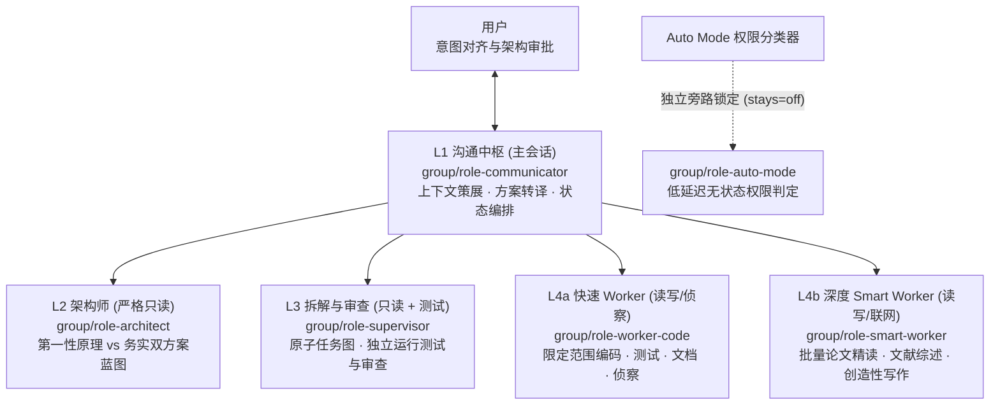

<div align="center">

# commlaude

**目录完全隔离的 Communication-First 多模型 Claude Code 编排层。**

将沟通中枢、只读架构规划、独立测审、快速编码、并行深度研究与 Auto Mode 权限分类拆分到 6 个解耦语义路由组——零侵入全局 `~/.claude/` 与原有 Magpie 绑定。

[](https://github.com/zhubaodian1027/commlaude/stargazers)


[English](./README.md) · **简体中文**

[60 秒上手](#60-秒极速上手) · [为什么做这个](#为什么选择-commlaude) · [五种入口](#五种按需提速入口) · [架构与角色组](#架构与语义角色组) · [验证与审计](#验证与模型归因审计) · [卸载回滚](#撤回--卸载)

</div>

---



```text
$ ./bin/orchestra-audit --since '2026-11-23T00:00:00Z'
| Requested                | Served         | Calls | Avg ms | Errors |
| ------------------------ | -------------- | ----- | ------ | ------ |
| group/role-communicator  | <hub-model>    |    12 |   6420 |      0 |
| group/role-architect     | <arch-model>   |     2 |  18900 |      0 |
| group/role-supervisor    | <review-model> |     4 |  14300 |      0 |
| group/role-worker-code   | <code-model>   |     8 |   4150 |      0 |
| group/role-smart-worker  | <smart-model>  |     5 |  22100 |      0 |
| group/role-auto-mode     | <fast-model>   |    19 |    910 |      0 |
```

> [!NOTE]
> 所有配置、子代理、技能、会话记录与冒烟测试产物都通过 `CLAUDE_CONFIG_DIR` 严格隔离在本仓库目录内，**不会修改全局 `~/.claude/`，也不会改动你原有的 Magpie 主模型、tier 或 subagent 绑定**。

---

## 为什么选择 `commlaude`？

### 开发初衷：重写“聪明模型驾驭效率模型”的旧范式

大多数多代理方案都默认同一种分工：**让最聪明的推理模型坐在主会话，去指挥便宜的效率子代理干活。**

但在真实高强度使用中，这套模式越来越别扭。我经常用 **GPT-6 Astra / GPT-6.2 Astra** 这类最高智能模型做技术参考和关键决策，但直接和它对话非常消耗精力——它太不讲人话，而且夹杂着大量防御性表达，真正有用的判断总要反复剥离。反观 **Gemini 4 Neon**，实际用下来非常顺手：有不俗的智慧、扎实的办事能力与效率，最难得的是**非常讲人话**（上一个让我如此满意的模型是 **Kimi K3**，可惜 **K3.1 Pro** 又被后训练成了不讲人话的风格）。

这让我意识到一个此前被忽略的核心问题：**在人机协作中，“能不能说人话”才是最影响使用体验和任务进度的关键。** 以往“聪明模型直面用户、再去驾驭效率模型”的子代理模式，或许需要更新了。

于是我开发了这套 **Communication-First** 模式：把最会沟通、办事利落、讲人话的模型放在主会话当总控中枢，把顶级推理模型请到幕后专注架构决策与独立审查，同时用 `group/role-*` 将角色与具体模型彻底解耦——哪怕某代模型后训练变味，也只需在路由层换人，工作流本身不受影响。

为了在保留深度推理与工程严谨性的前提下落地这套模式，`commlaude` 将协作拆分为 **6 个语义角色组** 与 **5 个按需命令档位**：

- **Communication-First 单中枢扁平编排**：Claude Code 子代理不能递归派生子代理，L1 主会话天然作为唯一状态机——提炼精简的 `00-brief.md`、按拓扑波次并行派发任务，不把整仓噪音倾倒给深度推理角色。
- **声音隔离（"Thinker Thinks, Communicator Speaks"）**：L2 架构师严格只读，只产出**激进第一性原理 vs 稳健务实**双方案蓝图；L1 负责落盘并转译成直指本质的人话，补充独立的工程批判，**经人明确批准后才允许改代码**。
- **写审分离与有界收敛**：Worker 只能在 `allowed_files` 范围内改动并运行 `verification_cmd`；L3 审查者拥有 `Read` + `Bash` 独立跑测权限但**没有文件写入工具**，单任务修订硬性封顶 **2 轮**。
- **角色与模型彻底解耦**：所有子代理、技能与命令只绑定语义角色组（`group/role-*`），不写死任何具体厂商或模型名。换模型、改回退链、配时段规则全在网关层完成，编排层零改动。

### 对比一览

| 维度 | 单模型 Claude Code | 手写零散子代理 | `commlaude` |
| --- | :---: | :---: | :---: |
| 沟通 / 架构 / 审查 / 快速编码 / 深度批量分工 | 无 | 手动切换 | **6 个语义 `group/role-*` 路由组** |
| 架构师只读 + 写代码前人工审批闸门 | 无 | 靠提示词自觉 | **工具权限 + 流程双约束** |
| 独立测试审查且禁止直接改代码 | 无 | 少见 | **强制隔离（`Read/Grep/Glob/Bash`）** |
| 原生并行批量研究/精读（`Agent` 波次而非后台 shell） | 手动 | 自行写脚本 | **`/smarter` + `smart-worker`** |
| Auto Mode 分类器独立锁定，不跟随主模型漂移 | 无 | 无 | **`CLAUDE_CODE_AUTO_MODE_SERVER=0`** |
| 零侵入 `~/.claude/` 且支持一键卸载 | 不适用 | 改写全局目录 | **目录隔离 + `./uninstall.sh`** |
| 事后核对 `Requested` 与 `Served` 真实模型归因 | 无 | 无 | **`./bin/orchestra-audit`** |

---

## 60 秒极速上手

**前置条件**：macOS / 类 Unix、Claude Code CLI（默认 `/opt/homebrew/bin/claude`，可用 `CLAUDE_BIN` 指定）、本机运行中的 Magpie 网关（默认 `http://127.0.0.1:3425`，或任意支持分组路由的 Anthropic 兼容本地网关）、Python 3（仅标准库，0 第三方依赖）。

```bash
# 1. 克隆仓库
git clone https://github.com/zhubaodian1027/commlaude.git && cd commlaude

# 2. 创建 6 个 group/role-* 路由组（首次运行会自动保存 Magpie 回滚快照）
./setup-magpie.sh

# 3. 静态校验并启动隔离环境
./bin/orchestra-verify && ./bin/claude-orchestra
```

正常校验输出：

```text
OK: 19 required files, agent routing, tool restrictions, and script syntax verified.
Isolated config: <repo>/.claude
Live Magpie routing is checked separately by scripts/routing_smoke_test.sh.
```

<details>
<summary><strong>可选：配置短命令 alias（<code>commlaude</code>）</strong></summary>

在 `~/.zshrc` 中加入带标记的区块（卸载脚本会自动识别并仅删除该区块）：

```zsh
# >>> commlaude isolated launcher >>>
alias commlaude='/path/to/commlaude/bin/claude-orchestra'
# <<< commlaude isolated launcher <<<
```

执行 `source ~/.zshrc` 后，即可在任意项目目录直接运行：

```bash
commlaude
commlaude --resume
commlaude --version
```

</details>

<details>
<summary><strong>可选：通过环境变量自定义每个角色组的模型链</strong></summary>

`setup-magpie.sh` 内置了一组参考映射；你无需改动脚本，直接传入逗号分隔的模型优先级列表即可覆盖：

```bash
ROLE_COMMUNICATOR_MODELS="<primary>,<fallback>" \
ROLE_ARCHITECT_MODELS="<primary>,<fallback>" \
ROLE_SUPERVISOR_MODELS="<primary>,<fallback>" \
ROLE_WORKER_CODE_MODELS="<primary>,<fallback>" \
ROLE_SMART_WORKER_MODELS="<primary>,<fallback>" \
ROLE_AUTO_MODE_MODELS="<primary>,<fallback>" \
./setup-magpie.sh
```

`setup-magpie.sh` 内置三条安全保护：
1. 首次运行自动保存带时间戳的 Magpie 回滚快照，快照名仅记录在被 git 忽略的 `.magpie-setup-state`。
2. 如发现同名 `group/role-*` 组已存在且非本安装创建，拒绝覆盖并退出。
3. 不修改现有 Magpie 主模型、四个 tier 或全局 subagent 绑定。

</details>

---

## 五种按需提速入口

按任务复杂度选择最轻的合适档位，避免小事走重流程，也避免大事缺少设计把关：

| 入口 | 协作路径 | 适用场景 | 关键约束 |
| --- | --- | --- | --- |
| `/astra <问题>` | `User ↔ L1 ↔ L2` | 架构讨论、难题诊断、第一性原理权衡 | 严格只读，不改代码 |
| `/worker <小型明确任务>` | `User ↔ L1 → 单 L4a` | 边界清晰的改代码/修 Bug、补测试、改文档或只读侦察 | 走 `worker`（默认可读写 `Execution Mode`，侦察走只读 `Scout Mode`），**无独立审查** |
| `/smarter <批量/创造性任务>` | `User ↔ L1 → 并行 L4b` | 批量论文精读、文献综述、深度调研写作、复杂分析 | 原生 `Agent` 分波次并行派发 `smart-worker`（`effort=high`，互不重叠的 `allowed_files`），**无独立 Kimi 审查** |
| `/kimi <明确任务>` | `User ↔ L1 → L3 → L4 → L3` | 设计已清楚的功能实现、缺陷修复、范围重构 | 跳过架构审批，保留独立测试与审查 |
| `/commlaude <复杂任务>` | `User ↔ L1 ↔ L2 → [审批] → L3 ↔ L4` | 复杂特性、大型重构、方案不确定的研发任务 | **架构经人明确批准后才写代码**，单任务最多 2 轮修订 |

多步编排会在目标项目的 `.orchestra/` 目录沉淀完整可追踪产物：

```text
<project>/.orchestra/<YYYYMMDD-HHMMSS>-<slug>/
├── 00-brief.md          # L1 提炼的问题定义、约束与验收标准
├── 01-blueprint.md      # L2 原始技术蓝图 + 人类审批结论
├── 02-tasks.json        # L3 拆解的原子任务图（含依赖、allowed_files 与 verification_cmd）
├── 03-reports/          # L4 各任务执行与验证证据
└── 04-review.md         # L3 独立测试与逐轮审查结论
```

---

## 架构与语义角色组

编排层只识别以下 **6 个语义路由组**，你可以按能力画像在 Magpie 中自由填入自己的模型与回退链：

| 角色层 | 语义路由组 | 权限边界 | 推荐能力画像（Model-Agnostic） | 默认路由策略 |
| --- | --- | --- | --- | --- |
| **L1 沟通中枢** | `group/role-communicator` | 主会话编排 | 沟通自然、上下文理解强、擅长总结转译与多步协作 | `routing=order` `stays=session` |
| **L2 架构师** | `group/role-architect` | 只读 + 联网检索 | 高深度推理、第一性原理建模、复杂架构与难题诊断 | `routing=order` `stays=session` |
| **L3 拆解与审查** | `group/role-supervisor` | 只读 + `Bash` 测试 | 任务分解严谨、边界条件敏感、擅长严格代码审查 | `routing=order` `stays=session` |
| **L4a 快速 Worker** | `group/role-worker-code` | 读写 + 测试 + 只读侦察 | 高性价比、响应快、代码实现准确且兼顾侦察与文档 | `routing=order` `stays=auto` |
| **L4b 深度 Smart Worker** | `group/role-smart-worker` | 读写 + 测试 + 联网检索 | 强推理、长文档忠实度与创造性综合能力强，适合并行精读论文与深度写作 | `routing=order` `stays=session` |
| **Auto Mode 分类器** | `group/role-auto-mode` | 权限安全分类 | 极低延迟、低成本、适合高频无状态权限判定 | `routing=order` `stays=off` |

> [!TIP]
> 运行时想调整任意角色的优先级或回退链，直接修改 Magpie 分组即可，无需重启会话或改提示词：
> ```bash
> magpie group set role-auto-mode models=<model-a>,<model-b>
> ```

---

## 验证与模型归因审计

### 静态检查与单元测试（不发起模型调用）

```bash
./bin/orchestra-verify
python3 -I -m unittest discover -s ./tests -p 'test_*.py'
```

### 真实路由冒烟测试与归因审计

```bash
# 向全部 4 个子代理角色组发起一次最小探测并核对网关日志
./scripts/routing_smoke_test.sh

# 仅读取本地 Magpie usage.jsonl 元数据（不读取提示词或密钥）
./bin/orchestra-audit
./bin/orchestra-audit --since '2026-11-20T00:00:00Z'
```

审计表会同时列出 `Requested`（请求的语义角色组）与 `Served`（实际提供服务的上游模型），发生自动回退时一目了然。

---

## 进阶配置与参考

<details>
<summary><strong>启动器环境变量与隔离机制</strong></summary>

`bin/claude-orchestra` 会自动完成：
- 将 `CLAUDE_CONFIG_DIR` 固定指向本仓库的 `.claude/`；
- 直连本机网关 `http://127.0.0.1:3425`（使用非机密本地占位令牌 `magpie-local`）；
- 清除继承的 `CLAUDE_CODE_SUBAGENT_MODEL`、`ANTHROPIC_MODEL` 等全局路由覆盖，防止干扰子代理路由；
- 将 Auto Mode 分类器锁定到 `group/role-auto-mode`（`CLAUDE_CODE_AUTO_MODE_SERVER=0`）；
- 以软链接方式自动桥接全局 `~/.claude/skills/` 中的个人 Skill（不覆盖内置 5 个编排 Skill，失效软链接自动清理，且被 `.gitignore` 排除）。

可选启动环境变量：
- `ORCHESTRA_MAIN_MODEL`：默认 `group/role-communicator`
- `ORCHESTRA_EFFORT`：默认 `high`
- `ORCHESTRA_INHERIT_SKILLS`：默认 `1`（设为 `0` 可禁用全局 Skill 桥接并清理已桥接软链接）
- `ORCHESTRA_GLOBAL_SKILLS_DIR`：默认 `~/.claude/skills`
- `MAGPIE_BASE_URL`：默认 `http://127.0.0.1:3425`
- `CLAUDE_BIN`：默认 `/opt/homebrew/bin/claude`

</details>

<details>
<summary><strong>目录隔离边界与隐私审计</strong></summary>

本环境只在以下被 `.gitignore` 排除的位置写入运行数据：
- `.claude/` 采用白名单机制：仅追踪 `agents/`、`commands/`、`skills/`，排除会话、设置、缓存与历史记录；
- 目标项目的 `.orchestra/`：多步编排工作流产物；
- 本目录的 `.smoke/`、`logs/`、`backups/`、`.magpie-setup-state`。

详见 [docs/PRIVACY_AUDIT.md](./docs/PRIVACY_AUDIT.md) 与 [docs/VERIFICATION.md](./docs/VERIFICATION.md)。

</details>

<details>
<summary><strong>常见问题</strong></summary>

- **启动时报网关连接失败**：确认本地 Magpie 正在运行，可执行 `magpie healthcheck`。
- **提示 `Model "group/role-..." isn't recognized · context assumed to be 200k tokens`**：这是 Claude Code 对自定义/分组模型 ID 的本地提示，不影响正常路由和调用。
- **某个角色实际走了回退模型**：用 `magpie group role-<角色>` 检查组内成员状态，再用 `./bin/orchestra-audit` 核对 `Requested` 与 `Served`。
- **如何无痛切回原生环境**：直接运行普通的 `claude` 命令即可，全局 `~/.claude/` 从未被改动。

</details>

---

## 撤回 / 卸载

先预览会被删除的范围（不修改任何内容）：

```bash
./uninstall.sh --dry-run --magpie
```

卸载本目录内的隔离环境、运行产物以及 `~/.zshrc` 中带标记的 `commlaude` alias（保留 Magpie 路由组）：

```bash
./uninstall.sh --yes
```

同时删除 6 个由本安装创建的 `group/role-*` 路由组：

```bash
./uninstall.sh --yes --magpie
```

> [!IMPORTANT]
> 卸载默认不会自动恢复整个 Magpie 快照，以免覆盖你之后做的无关调整。若希望完全回到安装前的 Magpie 状态，可查看本地 `.magpie-setup-state` 中的快照名并手动执行 `magpie use '<snapshot-name>'`。

---

## Roadmap

- [ ] GitHub Actions 自动化工作流（每次 Push/PR 自动运行 `bin/orchestra-verify` 与 `tests/`）
- [ ] 可选 `SubagentStop` Hook：在接收 `Status: DONE` 前校验存在非空验证输出
- [ ] 非 Magpie 网关（LiteLLM / OpenRouter 兼容代理）接入示例
- [ ] 使用 `vhs` 录制 `/commlaude` 与 `/smarter` 并行波次的终端演示动图

---

## Star History

<a href="https://www.star-history.com/#zhubaodian1027/commlaude&Date">
 <picture>
   <source media="(prefers-color-scheme: dark)" srcset="https://api.star-history.com/svg?repos=zhubaodian1027/commlaude&type=Date&theme=dark" />
   <source media="(prefers-color-scheme: light)" srcset="https://api.star-history.com/svg?repos=zhubaodian1027/commlaude&type=Date" />
   
 </picture>
</a>
